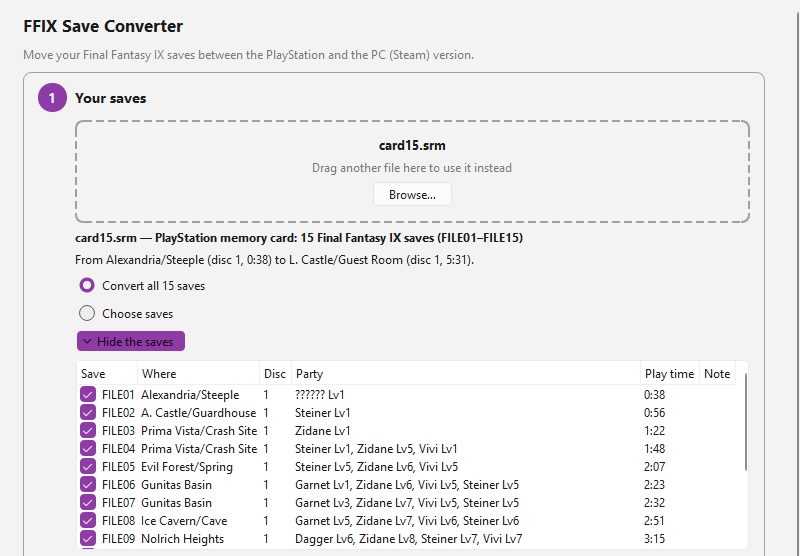
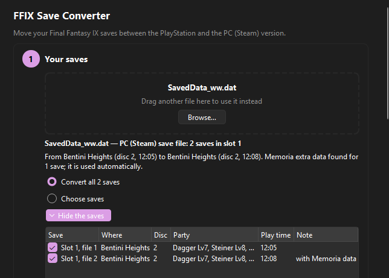
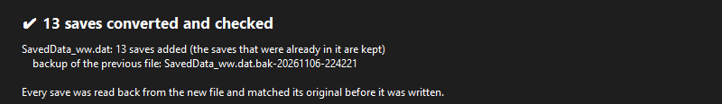

# FFIX Save Converter: Final Fantasy IX saves, PS1 ⇄ PC

Move a Final Fantasy IX playthrough between the original **PlayStation** version (emulator memory cards) and the
**2016 PC/Steam** version, in either direction. Story progress, location, party, levels, stats, abilities, equipment,
items, key items, gil and Tetra Master cards are carried over.



**Version 0.3.0-dev — development pre-release.** Both directions have been tested in the real games (details below),
but the package has only been run on the developer's Windows 11 PC, not yet on clean Windows 10/11 machines.

## Download

Get `FFIX-Save-Converter-0.3.0-dev-win-x64.zip` from the [Releases page](../../releases). It is a portable folder:
unzip it anywhere and start `FFIX Save Converter.exe` (desktop app) or use `ffix-convert.exe` (command line). No
installation or Python is needed. Requires Windows 10 or 11, 64-bit. Check the download against `SHA256SUMS.txt`.

| PC save → PlayStation (dark theme) | Result after a batch conversion |
|---|---|
|  |  |

## What's in 0.3.0-dev

- New: **batch conversion.** A whole PS1 memory card becomes one PC save slot (FILE01–FILE15 → files 1–15); a whole
  PC save file becomes as many memory cards as it needs. Selected saves only, existing destination files, and manual
  placement are supported. All files are written as one all-or-nothing operation.
- New: a redesigned **three-step desktop app** (your saves → where they go → convert) with plain-language messages and
  an Advanced section for the technical controls.
- From v0.2: **Memoria / Moguri** saves, including Memoria → PS1 (tested in the game with unmodified gameplay).
- PS1 → PC has been tested in the real Steam game: load, story continuation, battles, saving and reloading.
- PC → PS1 has been tested in DuckStation with the same kinds of checks. Batch conversion writes byte-for-byte the
  same save data as these tested single conversions.

See [COMPATIBILITY.md](COMPATIBILITY.md) for exactly what was tested and what wasn't.

## Desktop app (Windows 10/11 x64)

Unzip the package from the [Releases page](../../releases) anywhere and start **FFIX Save Converter.exe**. No
installation or Python needed.

1. **Your saves.** Drag a memory card or `SavedData_ww.dat` onto the window, or click Browse. The app says what it
   found (*"15 Final Fantasy IX saves (FILE01–FILE15)"*). Convert all of them (the default) or choose some.
2. **Where should they go?** The other version is chosen automatically. Create a new file (new memory cards), or add
   the saves to your existing PC save or memory card: the saves already in it are kept and a backup is made first.
   The app places the saves itself and says where (*"They go into slot 2, files 1–13"*).
3. **Convert.** Every save has already been converted and read back in memory before the button is enabled; anything
   that needs a decision (replacing saves, a damaged save, mod data) is explained right there. One click writes
   everything, or nothing.

Full guide: [docs/GUI_GUIDE.md](docs/GUI_GUIDE.md) (also `GUI_GUIDE.md` in the package, F1 in the app). Batch rules
(numbering, placement, cards, Memoria, transactions): [docs/BATCH.md](docs/BATCH.md).

Steam Cloud saves (`FF9_CloudSaveFile_ww.sav` and Steam's own folders) are never written to.

## Memoria and Moguri

Open the `SavedData_ww.dat` from the Memoria/Moguri game folder. Its Memoria data files
(`SavedData_ww_Memoria_*.dat`) are picked up automatically, separately for every save (the app's save list notes
them).
- **To PS1:** the save is reconstructed the way Memoria itself would load it. If a gameplay mod left data the
  PlayStation game cannot hold (mod items, raised HP limits, mod characters, …), the conversion is refused with the
  exact reasons. A clearly labelled lossy option can drop or clamp such values; every change goes into the report.
- **From PS1:** use the normal PS1 → PC conversion; Memoria reads vanilla saves. The converter refuses to write into a
  slot whose old Memoria data file would override the converted save.

Tested in the game with Memoria 2025-07-13 in both directions on a Disc 2 save, including the Moguri mod-folder
setup without its textures. Saves changed by gameplay mods remain experimental (refused when the PS1 cannot hold them).

## Supported files

| Platform | Formats |
|---|---|
| PS1 (input and output) | raw memory cards `.mcr` `.mcd` `.srm` (ePSXe, DuckStation, RetroArch/Beetle, …). Input only: DexDrive `.gme`, `.vmp`, `.psv`, `.mcs`, bare save blocks. Output: raw card or single-save `.mcs` |
| PC (input and output) | `SavedData_ww.dat` from the vanilla Steam release (2016), all 150 slots plus autosave |

Only the North American (NTSC-U) PS1 version is verified. PAL works with a warning; Japanese saves are refused.

## Command line (advanced)

`ffix-convert.exe` sits next to the app. Open a terminal in that folder.

```bash
ffix-convert inspect "Final Fantasy IX.srm"
```

`inspect` lists every FF9 save in the file with its block (PS1) or slot/file (PC) number, location, disc, party, playtime and gil.

```bash
ffix-convert convert "Final Fantasy IX.srm" --source 13
```

This converts PS1 memory-card block 13 to a **new** PC save file, written next to the input in
`Final Fantasy IX_converted_pc\SavedData_ww.dat`, plus a report.

```bash
ffix-convert convert SavedData_ww.dat --source 2/5
```

This converts PC slot 2, file 5 to a **new** PS1 memory card, `SavedData_ww_converted_ps1.mcr`.

```bash
ffix-convert verify "Final Fantasy IX.srm" "Final Fantasy IX_converted_pc\SavedData_ww.dat" --source-slot 13
```

`verify` independently re-reads both files and compares every shared field. It exits 1 on any unexpected difference.

### Many saves at once

```bash
ffix-convert batch "Final Fantasy IX.srm"
```

This converts every FF9 save on the card into one new PC save file (slot 1, FILE n → file n), next to the input.

```bash
ffix-convert batch "Final Fantasy IX.srm" --into SavedData_ww.dat --in-place --force
```

This adds them to your PC save file in its first empty slot, after a verified backup; the saves already there are kept.

```bash
ffix-convert batch SavedData_ww.dat --select 1/1 1/2 2/5 --out cards
```

This converts the chosen PC saves into memory cards `cards\FFIX-PS1-Card-01.mcr`, … with `conversion-manifest.txt`
saying which save went where. `--dry-run` checks everything without writing; `--json` prints the plan. If a batch is
ever interrupted, `ffix-convert recover <folder>` puts every file back. All options: [docs/BATCH.md](docs/BATCH.md).

### Choosing where the save goes

- **Into a new PC file at a chosen slot:** `--dest 3/1` puts it in PC slot 3, file 1.
- **Into a copy of your existing PC file:** `--into SavedData_ww.dat --dest 3/1 --out NewSavedData_ww.dat`. Your other slots are kept.
- **Into a copy of an existing memory card:** `--into MyCard.mcr --dest 4 --out MyCard_new.mcr`. FF9 save `FILE04` goes into the first free block; other saves are kept.
- **Into the destination file itself:** `--into FILE --in-place --force`. A verified backup (`FILE.bak-<time>`) is made first.
- **Memoria → PS1 with modded data:** add `--allow-lossy` to drop or clamp what the PS1 cannot hold (listed in the report).

### Using the result

- **PC (Steam):** close the game, back up `%USERPROFILE%\AppData\LocalLow\SquareEnix\FINAL FANTASY IX\Steam\EncryptedSavedData\SavedData_ww.dat`, then put the converted file there. **Do not use "Cloud Data → Upload"** unless you mean to replace your Steam Cloud save.
- **PS1 emulators:** use the converted card as the game's memory card. In DuckStation, for example, copy it to `memcards\Final Fantasy IX_1.mcd`, the per-game card name. Keep your original card as a backup.

## Safety

- **Inputs are never modified.**
- Outputs are written to a temporary file, **re-read and verified**, and then moved into place. A failed conversion leaves nothing behind.
- **Batches are all or nothing.** Every save is converted and verified in memory first; then all files are written as
  one journaled transaction. A failure or Cancel puts back every file already written (checked by SHA-256); a crash
  leaves a journal that `recover` (or the app) undoes.
- **Nothing is replaced without approval.** Occupied slots or FILE numbers are listed, and need `--replace` or the
  app's Replace tick. No force option can push unsupported gameplay data through; only the explicit, listed lossy
  option for Memoria data exists.
- Existing files are never replaced without `--force`. With `--force`, a backup is made first and checked byte-for-byte.
- **The same file under another name is detected.** Writing to a file that is the input through a hard link, junction, symlink, `..` path or different capitalization is refused.
- **Other saves are preserved.** Other memory-card blocks and other PC slots stay byte-identical; this is checked before writing.
- **Values that don't fit are never truncated.** Unrepresentable values, such as names with characters the PS1 can't display, values outside PS1 ranges or more than 105 Tetra Master cards, stop the conversion with an explanation.
- **Exit codes:** 0 = success, 1 = `verify` found differences, 2 = error (nothing written).

## What doesn't carry over

The report lists everything per conversion, graded *fully preserved*, *safely transformed*, *defaulted*, *lossy/unsupported* and *blocking*.

- **PC → PS1:**
  - Lost: Steam achievement tracking, PC options and key bindings, the world-map camera angle.
  - PS1-only bytes with unknown meaning are written as zero; the PS1 game rebuilds or keeps them, as observed in testing.
- **PS1 → PC:**
  - PS1 options and some PS1-only bytes have no PC equivalent; they're listed in the report.
  - PC options get the game's defaults, or come from `--template`.

## Building from source

Requires Python 3.11+, `cryptography`, and `PySide6-Essentials` for the desktop app.

```bash
python -m pip install cryptography PySide6-Essentials pytest pyinstaller
```

```bash
python -P -m pytest tests
```

```bash
pwsh -File tools/packaging/make_dev_build.ps1
```

To run from the checkout, set `PYTHONPATH=src`, then use `python -P -m ffix_conv.gui.app` for the app or
`python -P -m ffix_conv …` for the command line. The conversion engine (`ffix_conv`) does not need PySide6.

Most tests use save files that can't be redistributed. They skip when `fixtures/` is empty; see `tools/acquire.py`.

## More documentation

- [COMPATIBILITY.md](COMPATIBILITY.md) and [TESTING.md](TESTING.md)
- [CHANGELOG.md](CHANGELOG.md) and [NOTICES.md](NOTICES.md)
- Format research: `docs/FORMATS.md`, `docs/FIELD_MAPPING.md`, `docs/MEMORIA_RESEARCH.md`
- App guide and batch rules: `docs/GUI_GUIDE.md`, `docs/BATCH.md`
- Reports: `reports/RELEASE_READINESS_v0.3.md`, `reports/V0.2_STATUS.md`, `reports/RUNTIME_RESULTS.md`

## License

MIT. See [LICENSE](LICENSE). Third-party notices are in [NOTICES.md](NOTICES.md) and, in the Windows archive,
`THIRD_PARTY_LICENSES/`. The desktop app uses Qt for Python (PySide6) under the LGPL-3.0.

Final Fantasy IX is © Square Enix. This project is not affiliated with Square Enix. No game files, discs or saves are included.
